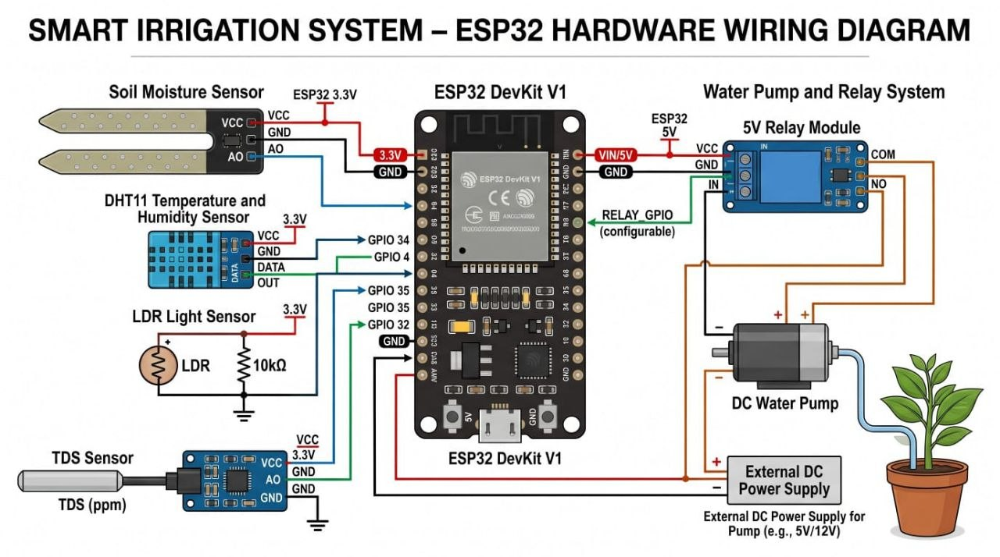
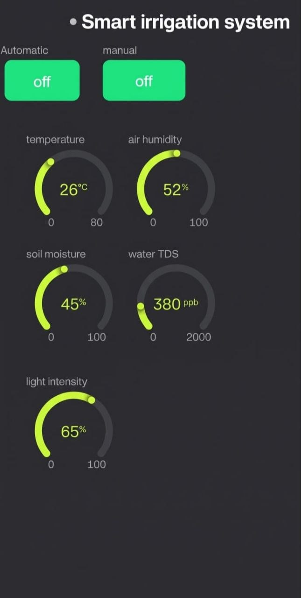

# Smart Irrigation System 🌱

## Project Overview
An IoT-based Smart Irrigation System designed to monitor environmental conditions and automate the irrigation process using ESP32. The system helps optimize water usage by monitoring soil conditions and controlling a water pump.

## Project Features
- Soil Moisture Monitoring.
- Temperature and Humidity Monitoring.
- Soil Salinity Monitoring.
- Real-Time Data Monitoring.
- Automatic Irrigation Mode.
- Manual Pump Control.
- Remote Monitoring and Control via Blynk IoT.
- LCD Display for sensor readings and system status.

## Hardware Components
- ESP32 Development Board.
- Soil Moisture Sensor.
- Temperature and Humidity Sensor (DHT).
- Soil Salinity Sensor.
- LCD Display.
- Relay Module.
- Water Pump.
- Power Supply.
- Jumper Wires.

## How It Works
The ESP32 reads data from the connected sensors and monitors the soil and environmental conditions.

In Automatic Mode, the system uses soil moisture readings to decide when irrigation is needed and controls the water pump through a relay.

In Manual Mode, the user can control the pump manually through the Blynk mobile application.

Sensor readings and system status can be monitored through the LCD and Blynk IoT platform.

## Technologies Used
- ESP32
- Arduino IDE
- C++
- Blynk IoT
- Internet of Things (IoT)
- Embedded Systems

## Project Images
Project photos and hardware implementation are included in this repository.

## Project Purpose
The main goal of this project is to develop a smart irrigation solution that reduces unnecessary water consumption, automates irrigation, and enables remote monitoring and control.

## Team Members
- Mohamed Saied
- Hazem Zidan
- Fady Ashraf
- Kirolos Ramsis

## Supervisor
Dr. Mohamed Torad

---

**Academic Project | IoT | Embedded Systems | Automation**
## Circuit Diagram

## Project Photos

